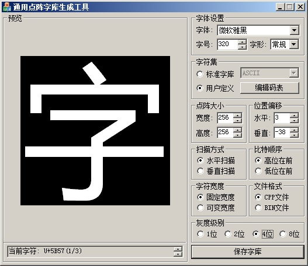

# 点阵字库生成工具

点阵字体在嵌入式GUI开发中，使用非常广泛。  
主要有两种使用场景：  
1.生成某种编码的全部点阵，以BIN的形式放在FLASH中加载。  
2.生成部份文字的点阵，以C文件的方式，写在代码里。  

- 本工具的特点：  
1.免费且开源，允许二次开发和定制;  
2.通用性好，支持任意编码，可以自定义编码;  
3.可以生成BIN和C文件;  
4.可以使用WINDOWS全部字体;  
5.支持生成灰度抗锯齿字库;  

- 运行界面

